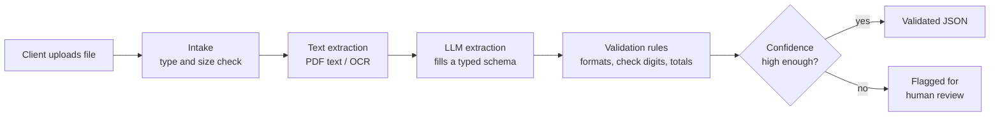

# ai-document-validator

[](https://github.com/julio002/ai-document-validator/actions/workflows/ci.yml)

API that extracts and validates data from PDFs and images with LLMs. Built with NestJS and TypeScript.

Companies receive documents (invoices, proofs of address, IDs) as scans, photos and PDFs, and
someone has to read each one, type the data into a system and check if it makes sense. This
project automates that: it reads the document, extracts the fields into JSON, validates them
with deterministic rules and flags what a human should review.

> Status: work in progress, built step by step. See [ROADMAP.md](ROADMAP.md).

## How it works



The LLM only fills the fields. Every value is then checked by plain code (for example the
check digits of a Brazilian CPF), because a model can return a well-formatted value that is
still wrong.

Done so far: **intake**. The other steps are on the roadmap.

## API

### `POST /documents/validate`

Send the document as `multipart/form-data` in the `file` field. Accepted: PDF, PNG and JPEG
up to 10 MB. The type is detected from the file content, not from its name.

```bash
curl -F "file=@invoice.pdf" http://localhost:3000/documents/validate
```

```json
{
  "documentId": "af842aeb-d6c4-4b20-a0eb-fbbdeb4c754c",
  "fileName": "invoice.pdf",
  "fileType": "pdf",
  "sizeBytes": 48213,
  "sha256": "79d6a59e1f914ed60b8216fcec3f3732c959e1636527e68c415bb52c1ef4ee79",
  "status": "received"
}
```

| Status | When |
| --- | --- |
| `202` | File received and accepted |
| `400` | No file in the `file` field, or empty file |
| `413` | File larger than 10 MB |
| `415` | Not a PDF, PNG or JPEG (even if the name ends in `.pdf`) |

### `GET /health`

Returns `{ "status": "ok", "uptimeSeconds": 42 }`.

## Running locally

Requires Node.js 20 or newer.

```bash
npm install
npm run start:dev      # http://localhost:3000
npm test               # unit tests
npm run test:e2e       # API tests
```

With Docker:

```bash
docker build -t ai-document-validator .
docker run -p 3000:3000 ai-document-validator
```

## Design decisions

Each important decision is written down in [docs/decisions](docs/decisions):

- [0001 — File intake: check the file signature, not the extension](docs/decisions/0001-file-intake.md)

## Data

Only synthetic sample documents are used in this repository. No real personal data.

## License

MIT
